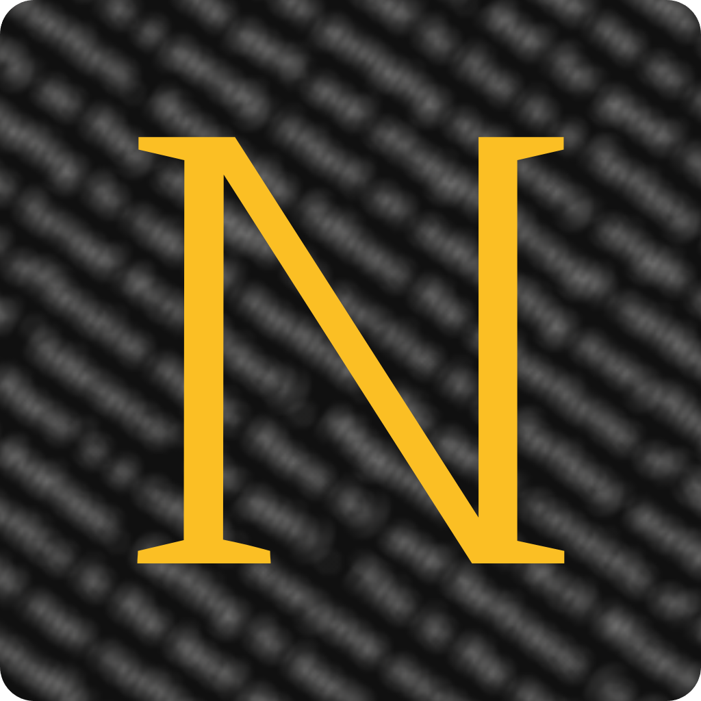

 

# *Notetxt*

A minimalistic note-taker app designed to let you jot down what you need with ease, without distractions — **no accounts, no subscriptions**, just you and your notes.

[**Open website →**](https://notetxt.vercel.app)

## ✨ Features

- Manage multiple notes in the [Note Manager](https://notetxt.vercel.app/editor?manager=open)
- Support for `.txt` and `.md` files
- Drag/drop existing files in the [Editor](https://notetxt.vercel.app/editor)
- Preview your notes in [Markdown](https://inttter.gitbook.io/notetxt/main/markdown)
- Organise your notes with tags
- Use [slash commands](https://inttter.gitbook.io/notetxt/main/slash-commands) to quickly insert Markdown syntax
- Download notes to your device
- View various metrics about your notes

## 📚 Documentation

To learn how to use Notetxt and its various other features, visit the [documentation](https://inttter.gitbook.io/notetxt).

## ⚖️ License

© **2025** - Notetxt is licensed under the [MIT License](LICENSE).